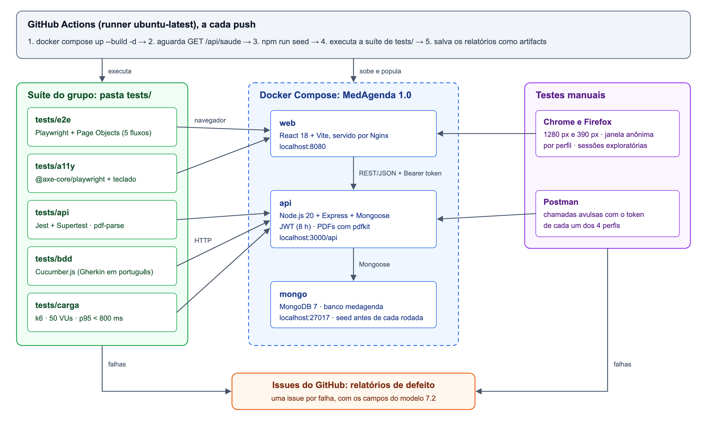
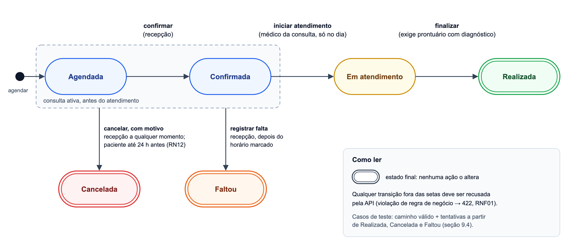
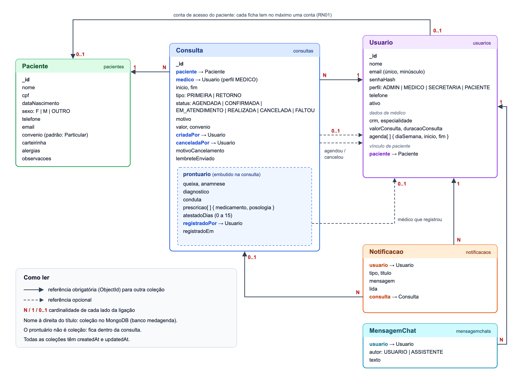

# MedAgenda – Plano de Testes e Validação

Projeto da disciplina **Teste de Software (2026.2)**, Ciências da Computação – Unifacisa.
Prof. Bruno Rafael Araújo Vasconcelos.

A equipe faz o papel de time de qualidade contratado pela Clínica MedAgenda para validar o sistema de agendamento e atendimento médico (React, Node.js, MongoDB e Docker) antes do uso com pacientes reais.

## Equipe

| Integrante | Papel |
|---|---|
| João Matheus de Figueirêdo Tavares | Líder de testes |
| Pedro Henrique de Paula Cabral | Analista de testes |
| Gabriel Arthur Gomes dos Santos | Engenheiro de automação |
| Saniel Martins Nóbrega | Testador e gestor de defeitos |

## Entregas

| Entrega | Data | Conteúdo | Situação |
|---|---|---|---|
| Entrega 1 | 19/11 | Plano de testes | Em andamento |
| Entrega 2 | 01/12 | Casos de teste, Gherkin, sessões exploratórias e matriz de rastreabilidade | A fazer |
| Entrega final | 15/12 | Suíte automatizada no CI, resultados, defeitos, relatório final e parecer | A fazer |

O documento de cada entrega é enviado pelo Canvas. Este repositório guarda o código dos testes, os diagramas e as issues de defeito.

## Estrutura

```
docs/diagramas/   diagramas do plano (arquitetura, estados da consulta e modelo de dados)
tests/api/        Jest + Supertest: regras de negócio, permissões e códigos HTTP
tests/e2e/        Playwright com Page Objects: fluxos completos pela interface
tests/bdd/        Cucumber.js: cenários Gherkin em português
tests/carga/      k6: horários livres e agenda do dia com 50 usuários
tests/a11y/       axe-core: telas de login, agendamento, notificações e assistente
```

O código do MedAgenda é fornecido pelo professor (`medagenda.zip`) e **não é alterado nem versionado aqui**, como pede o enunciado.

## Como subir o sistema para testar

Pré-requisito: Docker com Compose.

1. Extraia o `medagenda.zip` dentro desta pasta (fica em `medagenda/`, que está no `.gitignore`).
2. Suba o sistema:

   ```bash
   cd medagenda
   docker compose up --build
   ```

3. Confira se a API respondeu: `http://localhost:3000/api/saude` deve devolver `{"status":"ok","servico":"medagenda-api"}`.
4. Interface em `http://localhost:8080`.
5. Antes de cada rodada de testes, restaure os dados:

   ```bash
   docker compose exec api npm run seed
   ```

Os detalhes de instalação estão no Guia de execução do MedAgenda (material do professor).

## Diagramas







## Defeitos

Cada falha encontrada vira uma issue neste repositório, com os campos do modelo de relatório de defeito (seção 7.2 do enunciado): requisito violado, severidade e prioridade, ambiente, passos para reproduzir, resultado esperado e obtido, frequência e evidências.
